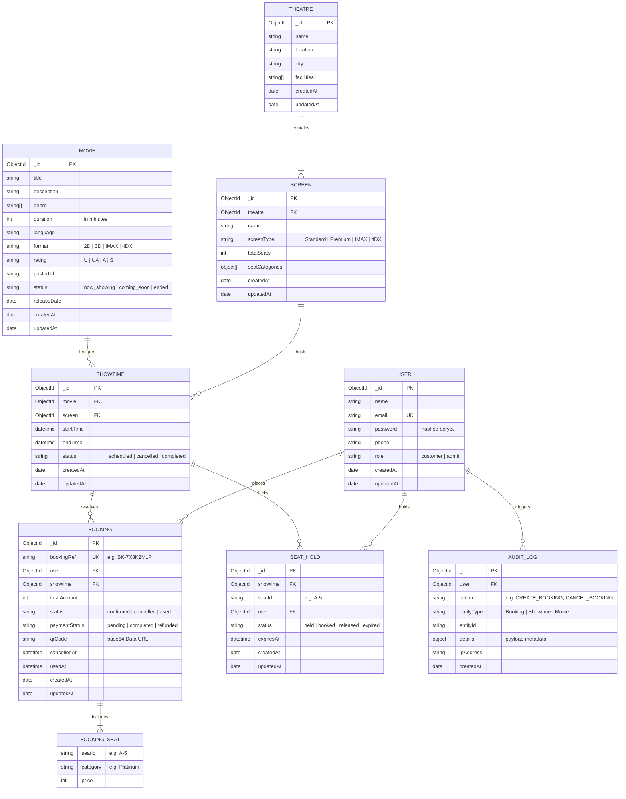

# 📊 Database Entity-Relationship (ER) Diagram & Schema Specification

This document provides the full data model, entity relationships, integrity constraints, and indexes for the **Cinema Hall Ticket Booking System**.

---

## 1. Visual Entity-Relationship Diagram (Mermaid)

---

## 2. Relational Integrity, Constraints & Indexes

| Collection | Field / Combination | Index Type | Constraint / Business Rule |
| :--- | :--- | :--- | :--- |
| **`User`** | `email` | Unique Single (`{ email: 1 }`, unique: true) | Guarantees single account per customer/admin email. |
| **`SeatHold`** | `showtime`, `seatId`, `status` | Compound Filtered (`{ showtime: 1, seatId: 1, status: 1 }`) | Prevents simultaneous active reservations for the same seat/showtime. |
| **`SeatHold`** | `expiresAt` | Single (`{ expiresAt: 1 }`) | Accelerates background job cleanup of expired temporary holds. |
| **`SeatHold`** | `showtime`, `status` | Compound (`{ showtime: 1, status: 1 }`) | Speeds up real-time occupancy calculations and seat availability queries. |
| **`Booking`** | `bookingRef` | Unique Single (`{ bookingRef: 1 }`, unique: true) | Guarantees uniqueness of ticket validation tokens and QR pass references. |
| **`Booking`** | `user`, `createdAt` | Compound (`{ user: 1, createdAt: -1 }`) | Fast retrieval of user booking history sorted chronologically. |
| **`Booking`** | `showtime`, `status` | Compound (`{ showtime: 1, status: 1 }`) | Optimizes revenue calculations and seat occupancy tracking. |
| **`Showtime`** | `screen`, `startTime`, `endTime` | Compound (`{ screen: 1, startTime: 1, endTime: 1 }`) | Collision prevention index; verified by API scheduler to reject overlapping shows. |
| **`Showtime`** | `movie`, `startTime` | Compound (`{ movie: 1, startTime: 1 }`) | Accelerates customer movie detail showtime discovery. |
| **`AuditLog`** | `createdAt`, `action` | Compound (`{ createdAt: -1, action: 1 }`) | Fast administrative audit inspection and timeline filtering. |

---

## 3. Detailed Entity Dictionary

### 3.1. `User`
Stores credentials and authorization identity:
- `_id`: Primary Key (BSON ObjectId)
- `name`: String (2 to 60 characters)
- `email`: String (RFC 5322 formatted, lowercased, indexed unique)
- `password`: String (Salted bcrypt hash with cost factor 10)
- `phone`: String (Optional contact number)
- `role`: Enum (`customer`, `admin`) - default: `customer`
- `createdAt`, `updatedAt`: Timestamps

### 3.2. `Movie`
Cinema film repertoire catalog:
- `_id`: Primary Key (BSON ObjectId)
- `title`: String (Unique movie title)
- `description`: String (Synopsis / storyline)
- `genre`: Array of Strings (`Action`, `Sci-Fi`, `Drama`, etc.)
- `duration`: Integer (Runtime in minutes)
- `language`: String (`English`, `Hindi`, `Spanish`, etc.)
- `format`: Enum (`2D`, `3D`, `IMAX`, `4DX`)
- `rating`: Enum (`U`, `UA`, `A`, `S` - Censor certification)
- `posterUrl`: String (URL to movie poster artwork)
- `status`: Enum (`now_showing`, `coming_soon`, `ended`)
- `releaseDate`: Date

### 3.3. `Theatre`
Multiplex venue information:
- `_id`: Primary Key (BSON ObjectId)
- `name`: String (e.g., PVR ICON Palladium)
- `location`: String (Physical street/mall address)
- `city`: String (e.g., Mumbai, Delhi, Bengaluru)
- `facilities`: Array of Strings (`Dolby Atmos`, `Recliners`, `Wheelchair Access`, `Food Court`)

### 3.4. `Screen`
Physical auditorium layout & tier specifications:
- `_id`: Primary Key (BSON ObjectId)
- `theatre`: Foreign Key -> `Theatre._id`
- `name`: String (e.g., Screen 1, Screen 2 - IMAX)
- `screenType`: Enum (`Standard`, `Premium`, `IMAX`, `4DX`)
- `totalSeats`: Integer (Auto-computed from tiers on save)
- `seatCategories`: Embedded subdocument array:
  - `name`: String (e.g., `Silver`, `Gold`, `Platinum`)
  - `price`: Number (Base ticket price for this tier)
  - `rows`: Array of row letter strings (e.g., `["A", "B"]`)
  - `seatsPerRow`: Integer (Total seat columns in each row)
  - `color`: Hex color string for frontend UI rendering

### 3.5. `Showtime`
Temporal screening schedule:
- `_id`: Primary Key (BSON ObjectId)
- `movie`: Foreign Key -> `Movie._id`
- `screen`: Foreign Key -> `Screen._id`
- `startTime`: ISO 8601 Date
- `endTime`: ISO 8601 Date (auto-computed: `startTime + duration + 15 min intermission`)
- `status`: Enum (`scheduled`, `cancelled`, `completed`)

### 3.6. `SeatHold`
Temporary pessimistic reservation buffer:
- `_id`: Primary Key (BSON ObjectId)
- `showtime`: Foreign Key -> `Showtime._id`
- `seatId`: String (Coordinate e.g., `A-5`, `B-12`)
- `user`: Foreign Key -> `User._id`
- `status`: Enum:
  - `held`: Active lock with expiration countdown (default 10 minutes)
  - `booked`: Converted to confirmed ticket via transaction
  - `released`: Manually released or cancelled
  - `expired`: Time window lapsed; eligible for reclamation
- `expiresAt`: ISO 8601 Date

### 3.7. `Booking`
Confirmed commercial ticket transaction:
- `_id`: Primary Key (BSON ObjectId)
- `bookingRef`: String (Format: `BK-XXXXXXXX`, Cryptographically random, Unique)
- `user`: Foreign Key -> `User._id`
- `showtime`: Foreign Key -> `Showtime._id`
- `seats`: Embedded array of booked seats (`seatId`, `category`, `price`)
- `totalAmount`: Number (Sum of booked seats)
- `status`: Enum (`confirmed`, `cancelled`, `used`)
- `paymentStatus`: Enum (`pending`, `completed`, `refunded`)
- `qrCode`: Base64 PNG Data URL containing `bookingRef`
- `cancelledAt`: Timestamp (set if cancelled)
- `usedAt`: Timestamp (set upon usher gate check-in)

### 3.8. `AuditLog`
Compliance and business action event trail:
- `_id`: Primary Key (BSON ObjectId)
- `user`: Foreign Key -> `User._id`
- `action`: String (`CREATE_BOOKING`, `CANCEL_BOOKING`, `VALIDATE_TICKET`, `CREATE_SHOWTIME`, etc.)
- `entityType`: String (`Booking`, `Showtime`, `Movie`, `Screen`)
- `entityId`: String
- `details`: Mixed Object (Contextual metadata, e.g. seat count, refund amount)
- `ipAddress`: String (Origin IP address)
- `createdAt`: Timestamp
