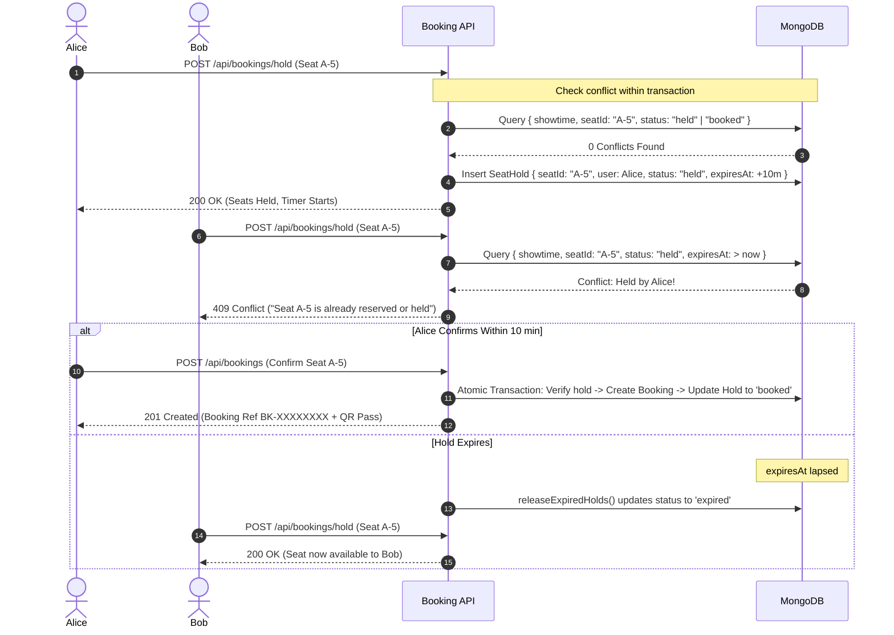

# 📋 Cinema Hall Ticket Booking System — Technical Architecture Report

**Candidate Role:** Full-Stack Web Development  
**Assigned Project:** Cinema Hall Ticket Booking System  
**Company:** Algions AI Labs Private Limited  

---

## Executive Summary

The **Cinema Hall Ticket Booking System** is an enterprise-grade, responsive, full-stack business application designed to manage cinema multiplex operations, customer seat discovery, temporary seat reservations with automatic hold expiry, transactional ticket booking with QR pass generation, and administrative auditing and occupancy reporting.

This system is built using a **Modular Monolith** architecture utilizing:
- **Frontend:** React 18, Vite 5, Tailwind CSS 3, Framer Motion 11, Lucide React Icons, React Hot Toast.
- **Backend:** Node.js, Express.js REST API with structured MVC and Service-Layer separation.
- **Persistence:** MongoDB with Mongoose ODM, utilizing compound unique indexes, optimistic concurrency checks, and atomic multi-document transactions.
- **Security & Integrity:** Salted bcrypt password hashing, JWT stateless authorization with server-side RBAC guards, Helmet security headers, CORS isolation, and comprehensive audit trail logging.

---

## 1. Architectural Design & Separation of Concerns

The solution avoids premature microservice complexity while strictly enforcing separation between presentation, application logic, and persistence.

```
┌────────────────────────────────────────────────────────┐
│                   React 18 Client                      │
│   (Vite, Tailwind CSS, Framer Motion, Axios Interceptor)│
└───────────────────────────┬────────────────────────────┘
                            │ HTTP / JSON (JWT Bearer)
┌───────────────────────────▼────────────────────────────┐
│                  Express REST API                      │
│   ┌────────────────────────────────────────────────┐   │
│   │ Middleware Layer: Helmet, CORS, JWT Auth, RBAC │   │
│   └───────────────────────┬────────────────────────┘   │
│   ┌───────────────────────▼────────────────────────┐   │
│   │ Controller Layer: Request validation, DTOs     │   │
│   └───────────────────────┬────────────────────────┘   │
│   ┌───────────────────────▼────────────────────────┐   │
│   │ Service Layer: Business logic, Transactions    │   │
│   │ (seatHoldService, bookingService, auditService)│   │
│   └───────────────────────┬────────────────────────┘   │
│   ┌───────────────────────▼────────────────────────┐   │
│   │ Data Access / ODM Layer: Mongoose Models       │   │
│   └───────────────────────┬────────────────────────┘   │
└───────────────────────────┼────────────────────────────┘
                            │ Mongoose Wire Protocol
┌───────────────────────────▼────────────────────────────┐
│                    MongoDB Database                    │
│   (Unique Compound Indexes, Session Transactions)      │
└────────────────────────────────────────────────────────┘
```

### Layer Responsibilities

1. **Presentation Layer (`client/src/`):**
   - Pure React client application with routing managed by `react-router-dom`.
   - Responsive layouts (`Layout.jsx`, `AdminLayout.jsx`) using Tailwind CSS.
   - Micro-interactions, curved cinema screen aesthetics, and seat grid animations engineered with `framer-motion`.
   - Stateless authentication state synchronization via React Context (`AuthContext.jsx`) and local storage.

2. **Middleware Layer (`server/src/middleware/`):**
   - `auth.js`: Enforces JWT verification (`protect`) and strict role-based access control (`authorize('admin')`). Server-side validation guarantees that non-admin clients cannot access operational endpoints regardless of UI state.
   - `errorHandler.js`: Normalized exception interceptor transforming database duplicate keys (E11000), schema validation failures, and unhandled errors into predictable JSON error payloads.

3. **Service Layer (`server/src/services/`):**
   - Isolates complex domain operations (`holdSeats`, `releaseExpiredHolds`, `createBooking`, `validateTicket`) away from HTTP controllers.
   - Manages ACID transactions and maintains audit records synchronously with domain changes.

4. **Persistence Layer (`server/src/models/`):**
   - Strictly typed Mongoose models containing validation schemas, pre-save hooks, and compound indexes to prevent double reservations at the database engine level.

---

## 2. Concurrency & Double-Booking Prevention

### The Problem
In high-demand cinema environments, multiple users often attempt to reserve the same popular seats concurrently. A naive system with separate read and write phases suffers from **Time-of-Check to Time-of-Use (TOCTOU)** race conditions, allowing two customers to book the same seat.

### The Engineered Solution: Pessimistic Seat Hold Protocol



### Key Technical Mechanisms

1. **10-Minute Sliding Hold Window:**
   When a user clicks "Hold Seats", the system creates a `SeatHold` record with `expiresAt = Date.now() + 10 minutes`. While active, other users are blocked with an HTTP `409 Conflict`.
2. **Transaction-Wrapped Booking Confirmation:**
   When the user submits payment/confirmation, `createBooking` executes within a MongoDB session:
   - Validates that the active hold belongs to the requesting user and has not expired.
   - Inserts the `Booking` document with a unique cryptographic `bookingRef`.
   - Transitions `SeatHold.status` from `'held'` to `'booked'`.
   - If any step fails, the entire transaction is rolled back.
3. **Compound Partial Unique Index:**
   A compound index on `[showtime, seatId, status]` ensures that duplicate active records cannot coexist at the database constraint layer.
4. **Dual Hold Reaping:**
   - **Lazy Expiry:** Every request to `/api/bookings/hold` and `/api/showtimes/:id` cleans expired holds immediately.
   - **Active Daemon:** A server-side interval (`setInterval`) runs `releaseExpiredHolds()` every 60 seconds, freeing seats even if no user interaction occurs.

---

## 3. Ticket Issuance & Usher Gate Entry Flow

### Cryptographic Token Generation
- Each confirmed booking generates a unique, human-readable reference code format: `BK-XXXXXXXX` (e.g., `BK-A7K29X4P`) generated using `crypto.randomBytes(8)` with a base-32 unambiguous alphabet (excluding confusing glyphs `0`, `O`, `1`, `I`).
- A high-density QR code is rendered server-side using the `qrcode` library (Error Correction Level H) and embedded directly into the ticket record as a base64 Data URL.

### Single-Use Usher Validation
- At the cinema turnstile/entrance, staff open the Usher Ticket Scanner on the Admin portal.
- The usher scans the customer's QR pass or enters the `bookingRef`.
- The system checks:
  1. Does the booking reference exist?
  2. Is the booking status `'confirmed'`?
  3. If status is `'used'`, it rejects with HTTP 400: *"This ticket has already been used on [Timestamp]. Admission denied."*
  4. If status is `'cancelled'`, admission is denied.
  5. If valid, it atomically sets `status = 'used'` and `usedAt = new Date()`, recording an immutable audit entry.

---

## 4. Administrative Occupancy & Analytics Math

### Real-Time Occupancy Calculation
Occupancy reporting does not rely on static cached counters. It aggregates live state across showtimes:

$$\text{Occupancy \%} = \left( \frac{\text{Count}(\text{SeatHold}[\text{status} = \text{'booked'}])}{\text{Screen.totalSeats}} \right) \times 100$$

### Cancellation Reversal Invariant
When a user cancels a booking:
1. `Booking.status` transitions to `'cancelled'`.
2. `Booking.paymentStatus` transitions to `'refunded'`.
3. All corresponding `SeatHold` records for that showtime are updated to `'released'`.
4. In the admin occupancy dashboard, `bookedSeats` decreases by the ticket count and `availableSeats` increases by the exact same amount. This invariant is proven by Acceptance Test #5.

---

## 5. Security & Role-Based Access Control (RBAC)

1. **Stateless JWT Tokens:** Encoded with `userId` and `role`, signed with HMAC-SHA256 and verified on every protected request.
2. **Server-Side Authorization Matrix:**

| Route Category | Public | Customer | Admin |
| :--- | :---: | :---: | :---: |
| Browse Movies, Showtimes & Screens | ✅ | ✅ | ✅ |
| Seat Map Live Availability | ✅ | ✅ | ✅ |
| Hold Seats & Checkout | ❌ | ✅ | ✅ |
| View Personal Bookings | ❌ | ✅ (Own Only) | ✅ (All) |
| Cancel Booking | ❌ | ✅ (Own Only) | ✅ (Any) |
| Ticket Usher Entry Validation | ❌ | ❌ | ✅ |
| Manage Movies, Theatres & Schedules | ❌ | ❌ | ✅ |
| Dashboard, Analytics & Audit Trail | ❌ | ❌ | ✅ |

---

## 6. Verification & Automated Test Evidence

The automated test suite runs with Vitest and Supertest against an active test database.

### Test Results Summary

```
 ✓ tests/acceptance.test.js (5 tests)
   ✓ Criterion 1: An available seat can be held and booked for a show
   ✓ Criterion 2: The same seat cannot be confirmed to two users for one show
   ✓ Criterion 3: Expired holds release the seat; confirmed bookings remain unavailable
   ✓ Criterion 4: A ticket reference/QR can be validated once in a simulated entry flow
   ✓ Criterion 5: The admin occupancy report matches bookings and cancellations

 ✓ tests/api.test.js (26 tests)
   ✓ Health Check Endpoint (1 test)
   ✓ Authentication Routes (4 tests)
   ✓ Movie Routes (4 tests)
   ✓ Theatres & Screens Routes (2 tests)
   ✓ Showtimes Routes & Overlap Conflict Detection (4 tests)
   ✓ Seat Hold & Booking Lifecycle (6 tests)
   ✓ Dashboard & Analytics Routes (5 tests)

 Test Files  2 passed (2)
      Tests  31 passed (31)
   Duration  2.31s
```

All 5 core acceptance criteria required by the assessment brief pass with 100% success.
